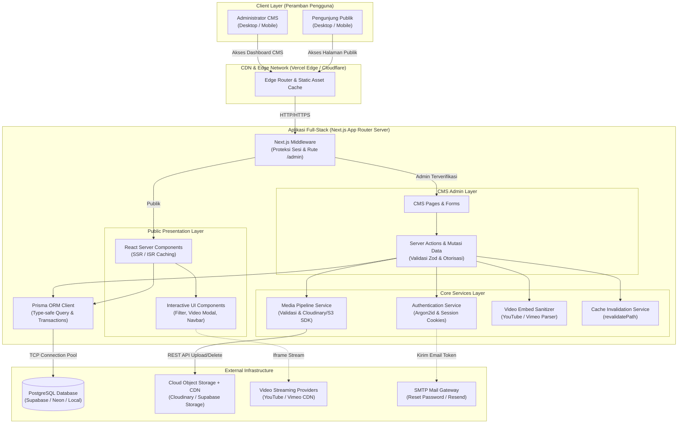
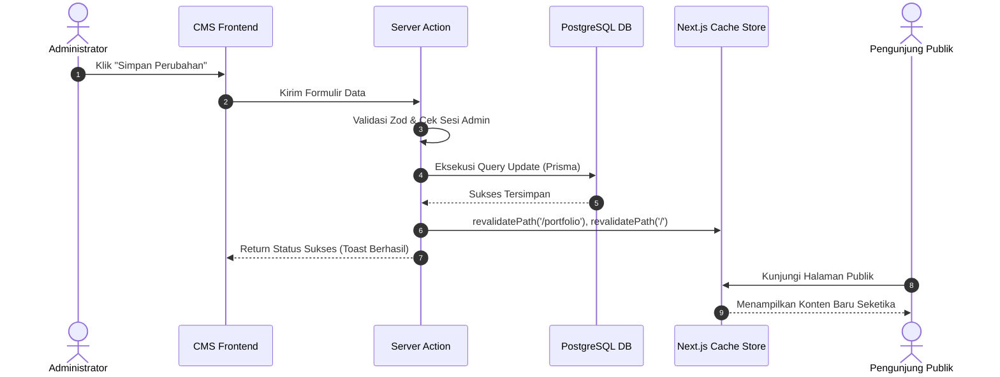
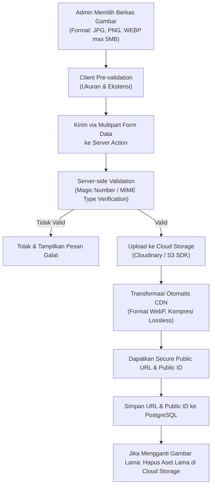

# SYSTEM DESIGN DOCUMENT
## Creatify Digital Portfolio

**Versi:** 1.0  
**Status:** Disetujui   
**Dokumen Acuan:** `00_PROJECT_BRIEF.md`, `01_PRD.md`, `02_SRS.md`, `03_INFORMATION_ARCHITECTURE.md`, `07_DECISION_LOG.md`

---

## 1. Pendahuluan

### 1.1 Tujuan Dokumen
Dokumen *System Design* ini mendefinisikan arsitektur teknis, pola rekayasa perangkat lunak, komponen sistem, aliran data, strategi keamanan, dan manajemen media untuk **Creatify Digital Portfolio**. Dokumen ini menjadi pedoman implementasi teknis bagi pengembang guna memastikan sistem dibangun dengan standar *best practice*, terukur, aman, dan mudah dipelihara.

### 1.2 Ruang Lingkup Sistem
Sistem Creatify Digital Portfolio merupakan aplikasi web *full-stack* modern yang terdiri dari:
1. **Website Publik:** Aplikasi penyaji konten cepat, teroptimasi SEO, responsif, dan interaktif untuk memperkenalkan profil dan karya Creatify.
2. **CMS (Content Management System):** Area internal terproteksi autentikasi yang menyediakan kontrol penuh kepada administrator untuk mengelola konten, media, data kepengurusan, dan status rekrutmen.

---

## 2. Arsitektur Sistem Tingkat Tinggi (*High-Level Architecture*)

Sistem mengadopsi arsitektur **Modern Monolith** menggunakan **Next.js (App Router)** dengan **TypeScript**. Pola ini menyatukan *frontend*, *backend API/Server Actions*, dan *middleware* dalam satu repositori terpadu tanpa memerlukan pemisahan server yang rumit.

### 2.1 Diagram Arsitektur Sistem



---

## 3. Struktur Modul & Pengorganisasian Kode (*Codebase Structure*)

Aplikasi menggunakan struktur direktori Next.js App Router yang memisahkan konteks publik dan CMS secara modular:

```
creatify/
├── prisma/
│   ├── schema.prisma           # Definisi skema database dan relasi
│   ├── migrations/             # Riwayat migrasi database
│   └── seed.ts                 # Seeder kategori awal & akun admin pertama
├── public/                     # Aset statis publik (logo, favicon, placeholder)
├── src/
│   ├── app/                    # Next.js App Router
│   │   ├── (public)/           # Route Group: Website Publik
│   │   │   ├── page.tsx        # Home Page (/)
│   │   │   ├── about/page.tsx  # About Page (/about)
│   │   │   ├── portfolio/
│   │   │   │   ├── page.tsx    # Galeri Portfolio (/portfolio)
│   │   │   │   └── [slug]/page.tsx # Detail Karya (/portfolio/[slug])
│   │   │   ├── join/page.tsx   # Join Creatify (/join)
│   │   │   ├── contact/page.tsx# Contact Page (/contact)
│   │   │   └── layout.tsx      # Layout Publik (Navbar & Footer)
│   │   ├── admin/              # Route Group: CMS Terproteksi
│   │   │   ├── login/page.tsx  # Halaman Login Admin
│   │   │   ├── (dashboard)/    # Area Dashboard Terproteksi
│   │   │   │   ├── layout.tsx  # Layout CMS (Sidebar, Topbar)
│   │   │   │   ├── page.tsx    # Dashboard Overview
│   │   │   │   ├── portfolio/  # Manajemen Karya & Kategori
│   │   │   │   ├── content/    # Manajemen Konten Halaman & Tim
│   │   │   │   └── settings/   # Kontak & Akun Admin
│   │   ├── api/                # API Handlers jika dibutuhkan webhook eksternal
│   │   ├── layout.tsx          # Root HTML Layout & Font Setup
│   │   └── not-found.tsx       # Custom Global 404 Page
│   ├── components/             # Reusable UI Components
│   │   ├── public/             # Komponen khusus halaman publik
│   │   ├── admin/              # Komponen khusus CMS (Form, Table, Modal)
│   │   └── ui/                 # Atomic UI primitives (Button, Input, Badge)
│   ├── lib/                    # Shared Libraries & Configs
│   │   ├── db.ts               # Prisma Client Singleton Instance
│   │   ├── auth.ts             # Session & Token Management
│   │   ├── media.ts            # Cloud Storage Helper (Upload & Delete)
│   │   ├── video.ts            # YouTube/Vimeo Regex Sanitizer
│   │   └── validations.ts      # Skema Validasi Zod
│   ├── actions/                # Server Actions untuk mutasi data CMS
│   │   ├── auth-actions.ts
│   │   ├── portfolio-actions.ts
│   │   ├── category-actions.ts
│   │   ├── content-actions.ts
│   │   └── member-actions.ts
│   └── types/                  # Definisi tipe TypeScript
├── scripts/
│   └── reset-admin.ts          # CLI Darurat untuk Reset Password Admin
├── .env.example                # Template variabel lingkungan
├── middleware.ts               # Proteksi rute /admin & verifikasi cookie
└── tsconfig.json
```

---

## 4. Pola Rendering, Data Fetching & Caching Strategy

Untuk menghasilkan website publik yang super cepat (*fast-loading*) sekaligus responsif terhadap pembaruan CMS, sistem mengkombinasikan **React Server Components (RSC)** dengan **On-Demand Cache Revalidation**.

### 4.1 Strategi Rendering

1. **Halaman Publik (`Home`, `About`, `Portfolio`, `Detail Karya`, `Join`, `Contact`):**
   - Dirender di sisi server menggunakan *React Server Components* (RSC).
   - Mengambil data langsung dari PostgreSQL via Prisma pada *build-time* atau *request-time*.
   - Menggunakan tag *cache* Next.js: `unstable_cache` atau *fetch cache tags*.
2. **Halaman CMS Admin (`/admin/*`):**
   - Dirender secara dinamis (*Dynamic Rendering / SSR*) dengan *header* `Cache-Control: no-store` untuk menjamin administrator selalu melihat data *real-time*.

### 4.2 Alur On-Demand Cache Invalidation

Ketika administrator menyimpan perubahan di CMS, sistem secara otomatis mengeksekusi fungsi pembongkaran cache (*cache purge*) menggunakan `revalidatePath()`:



---

## 5. Arsitektur Autentikasi & Keamanan Sesi (*Authentication & Security*)

Sesuai **ADR-003**, sistem mengimplementasikan autentikasi *single-admin* yang kokoh tanpa overhead dependensi eksternal yang tidak diperlukan.

### 5.1 Spesifikasi Sesi & Kredensial

- **Format Kata Sandi:** Dihash menggunakan **Argon2id** (memori: 65536 KiB, iterasi: 3, paralelisme: 4) atau **Bcrypt** (salt rounds: 12). Kata sandi teks asli tidak pernah disimpan atau dicatat dalam log.
- **Penyimpanan Sesi:** Menggunakan **Stateless Encrypted Cookie** (*Iron Session pattern* atau *Signed JWT*) dengan konfigurasi keamanan:
  ```typescript
  cookieOptions: {
    name: "creatify_admin_session",
    httpOnly: true,           // Mencegah pembacaan via JavaScript (Anti-XSS)
    secure: process.env.NODE_ENV === "production", // Wajib HTTPS
    sameSite: "lax",          // Proteksi terhadap CSRF
    path: "/",
    maxAge: 60 * 60 * 24 * 7  // Masa aktif sesi: 7 Hari
  }
  ```
- **Proteksi Rute (`middleware.ts`):**
  - Mencegat semua permintaan ke rute `/admin/*`.
  - Jika path bukan `/admin/login` atau `/admin/forgot-password`, periksa keberadaan dan tanda tangan cookie sesi.
  - Jika sesi tidak valid atau kedaluwarsa, lakukan *redirect* HTTP 307 ke `/admin/login`.

### 5.2 Alur Pemulihan Kata Sandi (*Password Recovery Flow*)

Sesuai **SRS FR-016** dan **ADR-009**, pemulihan kata sandi memiliki dua jalur:

1. **Jalur Standar (Email Token):**
   - Admin meminta reset pada halaman `/admin/forgot-password`.
   - Sistem menghasilkan token acak kriptografis (32 byte hex) dengan masa berlaku 1 jam (`reset_token_expires_at`).
   - Token dikirimkan ke email admin terdaftar melalui layanan email.
   - Admin membuka tautan `/admin/reset-password?token=...` dan memasukkan kata sandi baru.
   - Setelah berhasil, token langsung dihanguskan (*single-use*).
2. **Jalur Darurat Teknisi (Emergency CLI):**
   - Jika terjadi kendala pada layanan SMTP, pengembang atau teknisi internal dapat mereset kata sandi melalui terminal server secara aman:
     ```bash
     npm run admin:reset -- --password="KataSandiBaruYangKuat123!"
     ```
   - Skrip ini langsung memanggil pustaka hashing dan mengupdate record admin di database.

---

## 6. Pipeline Pengelolaan Media & Video Eksternal

### 6.1 Alur Unggah & Optimasi Media Gambar



### 6.2 Siklus Hidup Penghapusan Media (*Asset Cleanup*)
Untuk mencegah kebocoran media (*orphan files*):
- Setiap entitas yang memiliki gambar (`portfolio_items`, `team_members`) menyimpan atribut `media_public_id` di samping `media_url`.
- Saat fungsi hapus karya (`deletePortfolioItem`) atau ganti foto anggota dieksekusi, sistem secara asinkron memanggil API Cloud Storage untuk menghapus berkas fisik menggunakan `media_public_id`.

### 6.3 Validasi & Sanitasi Embed Video Eksternal

Sesuai **ADR-005**, sistem hanya menerima URL valid dari dua penyedia terpercaya:

| Platform | Format URL yang Didukung | Pola Ekstraksi Regex | URL Iframe Output yang Dirender |
|---|---|---|---|
| **YouTube** | `https://www.youtube.com/watch?v=VIDEO_ID`<br/>`https://youtu.be/VIDEO_ID` | `/(?:youtube\.com\/(?:[^\/]+\/.+\/|(?:v\|e(?:mbed)?)\/\|.*[?&]v=)\|youtu\.be\/)([^"&?\/\s]{11})/` | `https://www.youtube-nocookie.com/embed/{VIDEO_ID}` |
| **Vimeo** | `https://vimeo.com/VIDEO_ID` | `/(?:vimeo\.com\/)(\d+)/` | `https://player.vimeo.com/video/{VIDEO_ID}` |

Semua iframe dirender menggunakan komponen pemutar video terstandarisasi dengan atribut:
```html
<iframe
  src="{sanitizedEmbedUrl}"
  title="{title}"
  allow="accelerometer; autoplay; clipboard-write; encrypted-media; gyroscope; picture-in-picture"
  allowfullscreen
  loading="lazy"
  class="w-full aspect-video rounded-lg border-0"
></iframe>
```

---

## 7. Desain Keamanan (*System Security Architecture*)

Sistem dirancang dengan prinsip *Defense in Depth* guna melindungi dari ancaman keamanan OWASP Top 10:

1. **Pencegahan Injeksi SQL:**
   - Seluruh akses database menggunakan **Prisma ORM**, yang secara *default* menggunakan *parameterized queries* dan *prepared statements*.
2. **Pencegahan Cross-Site Scripting (XSS):**
   - React secara otomatis melakukan *string escaping* pada seluruh teks yang dirender.
   - Tidak ada penggunaan `dangerouslySetInnerHTML`.
   - Embed video menggunakan ekstraksi ID ketat, bukan menerima kode tag HTML mentah.
3. **Pencegahan Cross-Site Request Forgery (CSRF):**
   - Next.js Server Actions memiliki verifikasi *origin header* bawaan dan *SameSite cookies*.
4. **Validasi Skema Berlapis:**
   - Setiap mutasi input divalidasi di sisi klien dan wajib divalidasi ulang di sisi server menggunakan pustaka **Zod**.
5. **Keamanan Header HTTP (*Security Headers*):**
   Diimplementasikan melalui konfigurasi `next.config.js`:
   - `Content-Security-Policy (CSP)`
   - `X-Frame-Options: SAMEORIGIN` (mencegah Clickjacking)
   - `X-Content-Type-Options: nosniff` (mencegah MIME-sniffing)
   - `Referrer-Policy: strict-origin-when-cross-origin`
   - `Strict-Transport-Security (HSTS)`
6. **Rate Limiting:**
   - Menerapkan pembatasan percobaan login pada rute `/admin/login` (maksimal 5 percobaan per menit per alamat IP) untuk menggagalkan serangan *brute force*.

---

## 8. Penanganan Galat & Logging (*Error Handling & Observability*)

1. **Lapisan Penanganan Galat Antarmuka:**
   - Menggunakan *React Error Boundaries* (`error.tsx`) pada setiap segmen rute utama untuk menangkap galat tak terduga secara anggun (*graceful failure*) tanpa merusak seluruh aplikasi.
   - Pada CMS, galat validasi formulir ditampilkan langsung pada kolom input terkait (*field-level validation error*) dan pesan umum ditampilkan melalui komponen *Toast Alert*.
2. **Logging Server:**
   - Menggunakan *structured logging* sederhana pada Server Actions untuk mencatat aktivitas administratif krusial:
     - `[AUTH_LOGIN_SUCCESS]` Admin berhasil masuk (dengan stempel waktu dan IP ter-mask).
     - `[AUTH_LOGIN_FAILED]` Percobaan login gagal.
     - `[PORTFOLIO_MUTATION]` Tindakan Tambah, Edit, atau Hapus karya (beserta ID karya).
     - `[CATEGORY_MIGRATION]` Tindakan migrasi karya dari kategori lama ke kategori baru.

---

**Akhir dokumen `04_SYSTEM_DESIGN.md`**