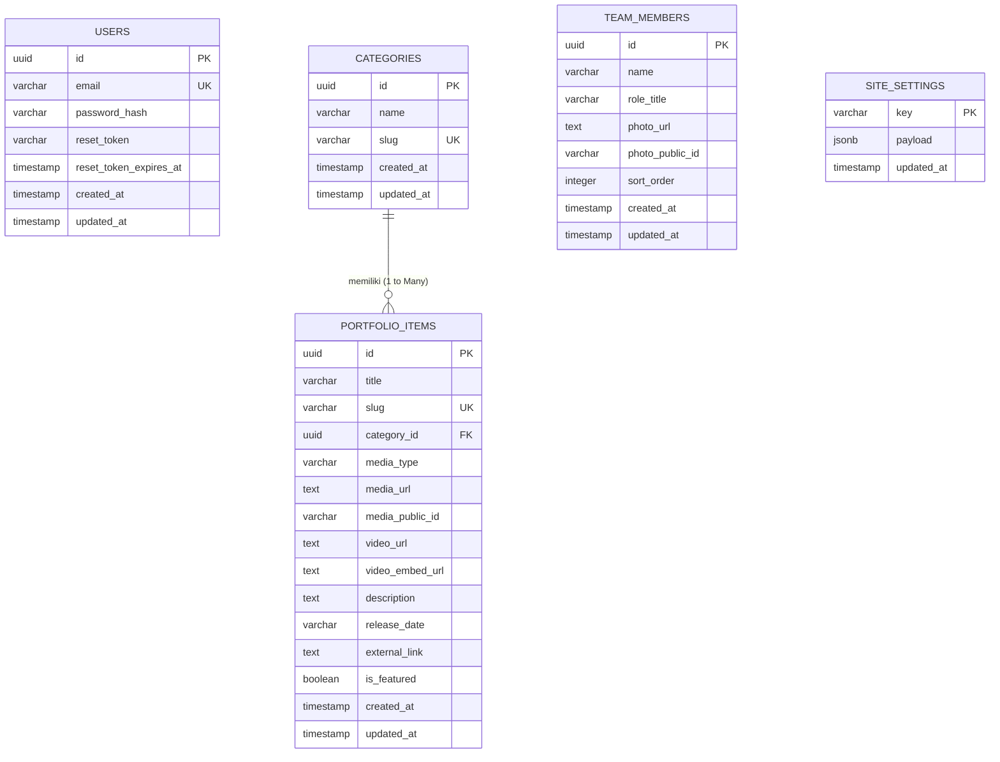

# DATABASE DESIGN DOCUMENT
## Creatify Digital Portfolio

**Versi:** 1.0  
**Status:** Disetujui  
**Dokumen Acuan:** `00_PROJECT_BRIEF.md`, `01_PRD.md`, `02_SRS.md`, `04_SYSTEM_DESIGN.md`, `07_DECISION_LOG.md`

---

## 1. Pendahuluan

### 1.1 Tujuan Dokumen
Dokumen *Database Design* ini mendefinisikan rancangan basis data relasional untuk sistem **Creatify Digital Portfolio**. Dokumen ini merinci diagram relasi entitas (*Entity-Relationship Diagram*), definisi struktur tabel, tipe data, kunci primer dan asing (*keys & constraints*), indeks optimasi performa, aturan integritas referensial, serta skrip inisialisasi awal (*seeding*).

### 1.2 Teknologi Basis Data
Sesuai **ADR-002**, sistem menggunakan:
- **DBMS:** **PostgreSQL** (versi 14 ke atas)
- **Object-Relational Mapping (ORM):** **Prisma ORM**
- **Strategi Penamaan:** Huruf kecil dengan garis bawah (*snake_case*) untuk tabel dan kolom database fisik; *camelCase* untuk representasi model pada kode Prisma/TypeScript.

---

## 2. Diagram Relasi Entitas (*Entity-Relationship Diagram / ERD*)

Berikut adalah representasi hubungan antarentitas dalam sistem:



---

## 3. Spesifikasi Rinci Tabel Basis Data

### 3.1 Tabel `users` (Administrator)
Menyimpan kredensial akun administrator utama untuk mengelola CMS.

| Nama Kolom | Tipe Data | Nullable | Default | Keterangan |
|---|---|---|---|---|
| `id` | `UUID` | NO | `gen_random_uuid()` | Primary Key unik. |
| `email` | `VARCHAR(255)` | NO | - | Alamat email admin (Unique, Case-insensitive). |
| `password_hash` | `VARCHAR(255)` | NO | - | Hash kata sandi menggunakan Argon2id atau Bcrypt. |
| `reset_token` | `VARCHAR(255)` | YES | `NULL` | Token acak kriptografis untuk alur lupa kata sandi. |
| `reset_token_expires_at` | `TIMESTAMP` | YES | `NULL` | Waktu kedaluwarsa token pemulihan (1 jam sejak dibuat). |
| `created_at` | `TIMESTAMP` | NO | `NOW()` | Waktu pembuatan akun. |
| `updated_at` | `TIMESTAMP` | NO | `NOW()` | Waktu pembaruan profil/kredensial terakhir. |

---

### 3.2 Tabel `categories` (Kategori Portofolio)
Menyimpan daftar kategori portofolio yang dapat dikelola secara dinamis.

| Nama Kolom | Tipe Data | Nullable | Default | Keterangan |
|---|---|---|---|---|
| `id` | `UUID` | NO | `gen_random_uuid()` | Primary Key unik. |
| `name` | `VARCHAR(100)` | NO | - | Nama tampilan kategori (misal: "Graphic Design"). |
| `slug` | `VARCHAR(100)` | NO | - | Identitas URL unik (misal: "graphic-design", Unique). |
| `created_at` | `TIMESTAMP` | NO | `NOW()` | Waktu pembuatan kategori. |
| `updated_at` | `TIMESTAMP` | NO | `NOW()` | Waktu modifikasi kategori. |

**Aturan & Indeks:**
- `UNIQUE INDEX idx_categories_slug (slug)`
- Kategori awal saat instalasi (*default seeds*): `Graphic Design`, `Social Media Content`, `Video`.

---

### 3.3 Tabel `portfolio_items` (Karya Portofolio)
Menyimpan seluruh data karya kreatif yang dipublikasikan oleh Creatify.

| Nama Kolom | Tipe Data | Nullable | Default | Keterangan |
|---|---|---|---|---|
| `id` | `UUID` | NO | `gen_random_uuid()` | Primary Key unik. |
| `title` | `VARCHAR(255)` | NO | - | Judul karya portofolio. |
| `slug` | `VARCHAR(255)` | NO | - | Slug URL unik ramah SEO (Unique). |
| `category_id` | `UUID` | NO | - | Foreign Key merujuk ke `categories(id)`. |
| `media_type` | `VARCHAR(20)` | NO | `'IMAGE'` | Tipe media utama: `'IMAGE'` atau `'VIDEO'`. |
| `media_url` | `TEXT` | NO | - | URL publik gambar sampul atau media utama (CDN). |
| `media_public_id` | `VARCHAR(255)` | YES | `NULL` | ID aset Cloud Storage untuk kebutuhan penghapusan berkas. |
| `video_url` | `TEXT` | YES | `NULL` | Tautan asli video (YouTube/Vimeo) jika bertipe Video. |
| `video_embed_url` | `TEXT` | YES | `NULL` | Tautan iframe player terverifikasi dan aman. |
| `description` | `TEXT` | YES | `NULL` | Penjelasan singkat atau latar belakang karya. |
| `release_date` | `VARCHAR(50)` | YES | `NULL` | Tanggal/tahun publikasi karya (misal: "2026"). |
| `external_link` | `TEXT` | YES | `NULL` | Tautan menuju postingan asli (misal: Instagram post). |
| `is_featured` | `BOOLEAN` | NO | `FALSE` | Penanda karya unggulan untuk seksi Home. |
| `created_at` | `TIMESTAMP` | NO | `NOW()` | Waktu penambahan karya. |
| `updated_at` | `TIMESTAMP` | NO | `NOW()` | Waktu pembaruan karya terakhir. |

**Aturan Integritas & Indeks:**
- `UNIQUE INDEX idx_portfolio_slug (slug)`
- `INDEX idx_portfolio_category_id (category_id)`
- `INDEX idx_portfolio_featured (is_featured)`
- `FOREIGN KEY (category_id) REFERENCES categories(id) ON DELETE RESTRICT`  
  *(Aturan `RESTRICT` menjamin kategori tidak dapat dihapus langsung jika masih memiliki karya yang bernaung di bawahnya, sesuai SRS FR-029).*

---

### 3.4 Tabel `team_members` (Struktur Kepengurusan & Anggota)
Menyimpan informasi anggota tim kreatif yang ditampilkan pada halaman About.

| Nama Kolom | Tipe Data | Nullable | Default | Keterangan |
|---|---|---|---|---|
| `id` | `UUID` | NO | `gen_random_uuid()` | Primary Key unik. |
| `name` | `VARCHAR(150)` | NO | - | Nama lengkap anggota. |
| `role_title` | `VARCHAR(150)` | NO | - | Jabatan atau peran spesifik di Creatify. |
| `photo_url` | `TEXT` | NO | - | URL foto profil anggota (Cloud CDN). |
| `photo_public_id` | `VARCHAR(255)` | YES | `NULL` | ID aset Cloud Storage untuk kebutuhan pembersihan berkas lama. |
| `sort_order` | `INTEGER` | NO | `0` | Angka urutan tampilan manual (nilai kecil tampil lebih awal). |
| `created_at` | `TIMESTAMP` | NO | `NOW()` | Waktu penambahan data. |
| `updated_at` | `TIMESTAMP` | NO | `NOW()` | Waktu pembaruan data anggota. |

**Aturan & Indeks:**
- `INDEX idx_team_sort_order (sort_order ASC)`

---

### 3.5 Tabel `site_settings` (Konfigurasi Konten Halaman Dinamis)
Menyimpan konten teks halaman publik, status rekrutmen, dan kanal media sosial dalam bentuk dokumen JSON terstruktur (*Key-Value Settings*).

| Nama Kolom | Tipe Data | Nullable | Default | Keterangan |
|---|---|---|---|---|
| `key` | `VARCHAR(50)` | NO | - | Primary Key pengenal seksi konten. |
| `payload` | `JSONB` | NO | `'{}'` | Objek JSON memuat konfigurasi seksi terkait. |
| `updated_at` | `TIMESTAMP` | NO | `NOW()` | Waktu pembaruan terakhir. |

#### Struktur Entri `key` & Skema `payload` JSONB yang Didukung:

1. **Key: `'home_hero'`**
   ```json
   {
     "headline": "Creative Engine for Faculty Branding",
     "subheadline": "Mendukung komunikasi visual, desain grafis, dan publikasi media Fakultas Ilmu Komputer.",
     "cta_primary_text": "Lihat Portofolio",
     "cta_secondary_text": "Tentang Kami"
   }
   ```
2. **Key: `'about_content'`**
   ```json
   {
     "tagline": "Crafting Impact Through Visual Stories",
     "profile_text": "Creatify adalah tim kreatif resmi yang berdedikasi...",
     "vision_goals": [
       "Meningkatkan engagement publikasi fakultas",
       "Wadah pengembangan talenta kreatif mahasiswa",
       "Standarisasi identitas visual acara kampus"
     ],
     "faculty_contribution": "Sebagai garda terdepan komunikasi visual..."
   }
   ```
3. **Key: `'recruitment'`**
   ```json
   {
     "is_open": false,
     "title": "Open Recruitment Creatify 2026",
     "description": "Kami mencari talenta kreatif di bidang Graphic Design, Social Media, dan Video...",
     "form_url": "https://forms.gle/sampleLinkRecruitment"
   }
   ```
4. **Key: `'contact_socials'`**
   ```json
   {
     "instagram_handle": "@creatify.fasilkom",
     "instagram_url": "https://instagram.com/creatify.fasilkom",
     "email": "creatify@cs.university.ac.id",
     "tiktok_handle": "@creatify.fasilkom",
     "tiktok_url": "https://tiktok.com/@creatify.fasilkom"
   }
   ```

---

## 4. Skema Prisma Lengkap (`prisma/schema.prisma`)

Berikut adalah berkas deklarasi skema Prisma yang siap digunakan dalam implementasi kode:

```prisma
datasource db {
  provider = "postgresql"
  url      = env("DATABASE_URL")
}

generator client {
  provider = "prisma-client-js"
}

model User {
  id                  String    @id @default(uuid()) @db.Uuid
  email               String    @unique @db.VarChar(255)
  passwordHash        String    @map("password_hash") @db.VarChar(255)
  resetToken          String?   @map("reset_token") @db.VarChar(255)
  resetTokenExpiresAt DateTime? @map("reset_token_expires_at")
  createdAt           DateTime  @default(now()) @map("created_at")
  updatedAt           DateTime  @updatedAt @map("updated_at")

  @@map("users")
}

model Category {
  id             String          @id @default(uuid()) @db.Uuid
  name           String          @db.VarChar(100)
  slug           String          @unique @db.VarChar(100)
  createdAt      DateTime        @default(now()) @map("created_at")
  updatedAt      DateTime        @updatedAt @map("updated_at")
  portfolioItems PortfolioItem[]

  @@map("categories")
}

enum MediaType {
  IMAGE
  VIDEO
}

model PortfolioItem {
  id             String    @id @default(uuid()) @db.Uuid
  title          String    @db.VarChar(255)
  slug           String    @unique @db.VarChar(255)
  categoryId     String    @map("category_id") @db.Uuid
  category       Category  @relation(fields: [categoryId], references: [id], onDelete: Restrict)
  mediaType      MediaType @default(IMAGE) @map("media_type")
  mediaUrl       String    @map("media_url") @db.Text
  mediaPublicId  String?   @map("media_public_id") @db.VarChar(255)
  videoUrl       String?   @map("video_url") @db.Text
  videoEmbedUrl  String?   @map("video_embed_url") @db.Text
  description    String?   @db.Text
  releaseDate    String?   @map("release_date") @db.VarChar(50)
  externalLink   String?   @map("external_link") @db.Text
  isFeatured     Boolean   @default(false) @map("is_featured")
  createdAt      DateTime  @default(now()) @map("created_at")
  updatedAt      DateTime  @updatedAt @map("updated_at")

  @@index([categoryId])
  @@index([isFeatured])
  @@map("portfolio_items")
}

model TeamMember {
  id            String   @id @default(uuid()) @db.Uuid
  name          String   @db.VarChar(150)
  roleTitle     String   @map("role_title") @db.VarChar(150)
  photoUrl      String   @map("photo_url") @db.Text
  photoPublicId String?  @map("photo_public_id") @db.VarChar(255)
  sortOrder     Int      @default(0) @map("sort_order")
  createdAt     DateTime @default(now()) @map("created_at")
  updatedAt     DateTime @updatedAt @map("updated_at")

  @@index([sortOrder])
  @@map("team_members")
}

model SiteSetting {
  key       String   @id @db.VarChar(50)
  payload   Json     @default("{}")
  updatedAt DateTime @updatedAt @map("updated_at")

  @@map("site_settings")
}
```

---

## 5. Alur Transaksi Khusus: Penghapusan & Migrasi Kategori

Sesuai **SRS FR-028, FR-029** dan **ADR-008**, proses penghapusan kategori wajib dijalankan menggunakan **Database Transaction** agar data selalu konsisten secara atomik:

```typescript
// Implementasi transaksi atomik pada Server Action
export async function deleteCategoryWithMigration(targetCategoryId: string, replacementCategoryId: string) {
  return await prisma.$transaction(async (tx) => {
    // 1. Cek jumlah total kategori aktif
    const totalCategories = await tx.category.count();
    if (totalCategories <= 1) {
      throw new Error("Kategori tidak dapat dihapus karena hanya tersisa satu kategori aktif.");
    }

    // 2. Validasi kategori pengganti
    const replacement = await tx.category.findUnique({
      where: { id: replacementCategoryId }
    });
    if (!replacement || replacement.id === targetCategoryId) {
      throw new Error("Kategori pengganti tidak valid.");
    }

    // 3. Pindahkan semua karya dari kategori target ke kategori pengganti
    await tx.portfolioItem.updateMany({
      where: { categoryId: targetCategoryId },
      data: { categoryId: replacementCategoryId }
    });

    // 4. Hapus kategori target
    const deleted = await tx.category.delete({
      where: { id: targetCategoryId }
    });

    return deleted;
  });
}
```

---

## 6. Strategi Inisialisasi Data (*Seeding Strategy*)

Skrip seeder (`prisma/seed.ts`) memastikan saat aplikasi pertama kali diinisialisasi di lingkungan pengujian maupun produksi, data awal yang wajib telah tersedia:

1. **Akun Administrator Utama:**
   - Email: `admin@creatify.fasilkom.ac.id` (dapat dikonfigurasi via environment variable).
   - Kata Sandi Awal: Ter-hash secara aman.
2. **Kategori Awal (SRS FR-030):**
   - `Graphic Design` (slug: `graphic-design`)
   - `Social Media Content` (slug: `social-media-content`)
   - `Video` (slug: `video`)
3. **Konfigurasi Awal Konten (`site_settings`):**
   - Inisialisasi payload default untuk `'home_hero'`, `'about_content'`, `'recruitment'`, dan `'contact_socials'` agar website publik langsung dapat menyajikan tampilan yang utuh tanpa error *null pointer*.

---

**Akhir dokumen `05_DATABASE_DESIGN.md`**
